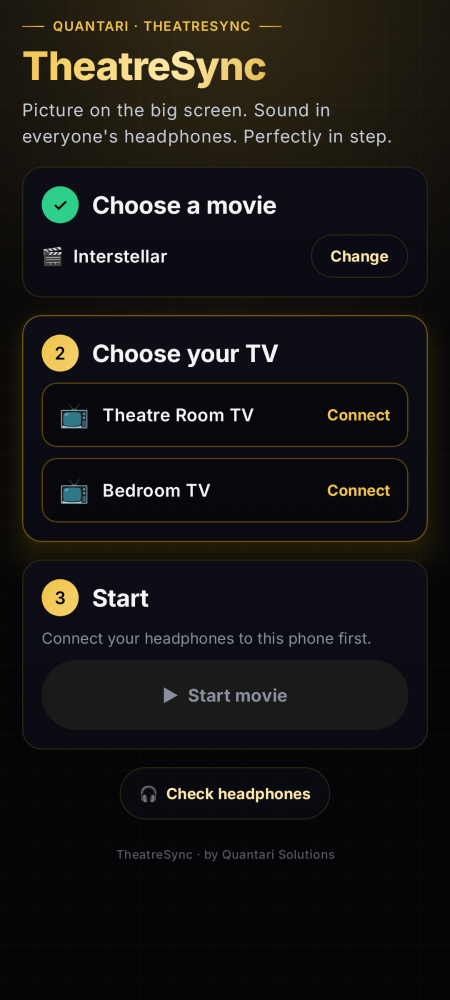
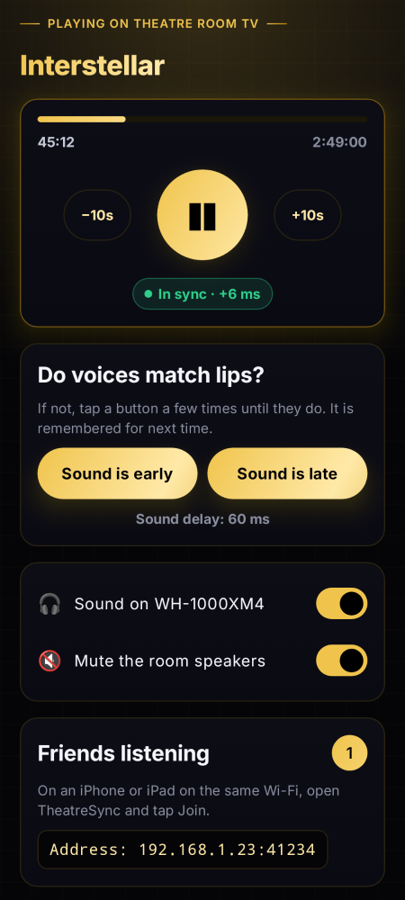

# TheatreSync

Bluetooth + Chromecast audio/video sync for a home theatre room.

Movie on the projector (Chromecast → AV receiver), sound in everyone's Bluetooth
headphones, in sync. The Android phone starts the movie; friends join on iPhone/iPad.

**Using it:** [docs/MOVIE-NIGHT.md](docs/MOVIE-NIGHT.md) · **Netflix & co:** [docs/STREAMING-APPS.md](docs/STREAMING-APPS.md)

> **Status:** Milestone 1, movie night for your own files. See [PROJECT-STATUS.md](PROJECT-STATUS.md).

## Screens

<p>


</p>

Rendered automatically from the real app code by [Paparazzi](https://github.com/cashapp/paparazzi) on every build.

## Repository layout

| Path | What it is |
|---|---|
| [`android/`](android) | Kotlin/Gradle Android app (`app`) + pure-Kotlin sync engine (`sync-core`) |
| [`ios/TheatreSync.swiftpm`](ios/TheatreSync.swiftpm) | SwiftUI app package for **Swift Playgrounds on iPad** |
| [`contracts/`](contracts) | Shared JSON protocol schema + fixtures — the single source of truth both apps follow |
| [`scripts/`](scripts) | Cloud setup, build and test scripts |
| [`docs/`](docs) | Architecture, workflow, iPad and physical-testing guides |

## Quick start (cloud — no local PC needed)

```bash
./scripts/run-tests.sh        # contracts + iOS static checks + Android tests & lint
./scripts/build-android.sh    # -> dist/TheatreSync-debug.apk
```

Every pull request runs these in GitHub Actions and attaches the APK as a
downloadable artifact. See [docs/CLOUD-WORKFLOW.md](docs/CLOUD-WORKFLOW.md).

## What "verified" means here

* **Cloud-verified:** compiles, unit tests, lint, schema validation.
* **Emulator-verified:** the Android app runs on an Android 14 emulator in CI (UI, server, real audio sync).
* **iOS:** shared sync code compiled + tested with Swift for Linux; the app itself is compiled when you open it in Swift Playgrounds.
* **Hardware-verified:** only after a physical test in [docs/PHYSICAL-TESTING.md](docs/PHYSICAL-TESTING.md) is reported back.

Cloud builds never prove Bluetooth, audio capture, or Cast behaviour.
